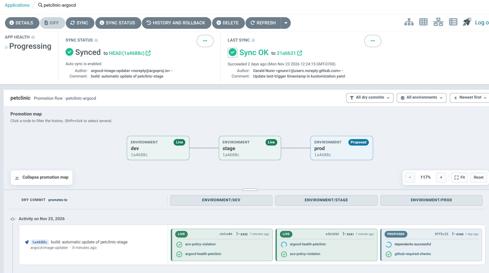
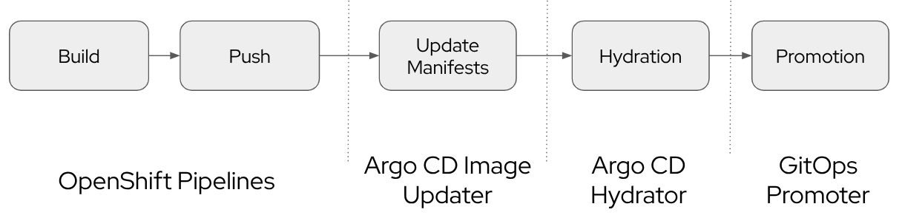

### Introduction

This is a demonstration using the [GitOps Promoter](https://gitops-promoter.readthedocs.io/en/latest/)
to manage the promotion of an application, Petclinic, across multiple environments (dev, stage, prod).

Currently this demo is tied to my homelab clusters and the infrastructure
already deployed on it, in the future I plan to make it available more
generically in the RHDP environment.

### DevOps Process

This demo shows the process of deploying an application from compiling the application,
creating an image, updating the manifests to finally the actual deployment across the
environments. A variety of components in the Red Hat stack work together for this process
as shown here:

In addition to the products directly involved, the demo also uses other products to
support the full Trusted Software Supply Chain (TSSC) including:

* **Red Hat Advanced Cluster Security**: Detects vulnerabilities and runtime security issues. Used
by GitOps Promoter to gate on failed ACS policies. Also used to generate an SBOM for the image.
* **Red Hat Trusted Artifact Signer**: Signs the built images automatically using Tekton Chains
* **Red Hat Trusted Profile Analyzer**: Receives generated SBOM when image is built, not currently
used for gating purposes since RHACS provides this already
* **Red Hat Build of Keycloak**: Authentication and OIDC Issuer for keyless signing performed by RHTAS
* **Red Hat Hardened Images**: Uses a hardened openjdk:21 image to minimize CVEs
* **Quay.io**: The image repository to host the [image](https://quay.io/repository/gnunn/quarkus-petclinic).

### Gating

The demo currently gates promotions based on whether any ACS critical policy failures are detected. It
also integrates with GitHub checks to ensure they are reflected in the Promoter UI.

### Test Containers

The quarkus application leverages Test Containers to support unit tests, Kubernetes user namespaces
are used to enable running podman on the host safely and securely. More details on this can be
viewed in this [blog](https://developers.redhat.com/blog/2026/11/19/openshift-pipelines-and-test-containers).

The application source code is in the [quarkus-petclinic](https://github.com/gnunn-gitops/quarkus-petclinic)
repository.

### Infrastructure

This demo is designed as a multitenant Argo CD example, all of the infrastructure it depends on is managed
by the platform team whereas the repo is the Application team's repo.

To view the infrastructure for this demo, as well as everything else deployed in my homelab clusters, visit
the [cluster-config-v2](https://github.com/gnunn-gitops/cluster-config-v2) repository.
